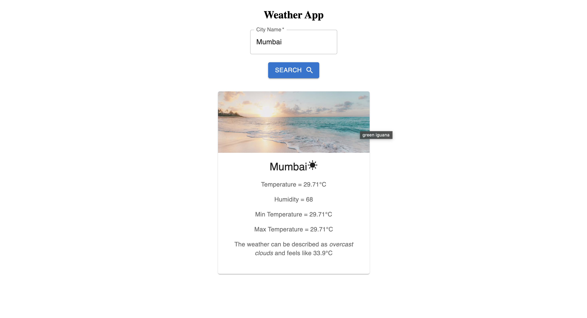

🌦️ React Weather App

A clean, responsive weather application built with React that lets users search for cities and view real-time weather information using the OpenWeatherMap API.

🚀 Features

* 🔍 Search weather by city name
* 🌡️ Current temperature in Celsius
* 💧 Humidity and feels-like temperature
* 🌤️ Weather conditions with visual imagery
* 📊 Minimum and maximum temperature
* ⚠️ Invalid-city and API error handling
* 📱 Responsive user interface

🛠️ Tech Stack

* Frontend: React, JavaScript, HTML5, CSS3
* UI Components: Material UI
* API: OpenWeatherMap
* Build Tool: Vite

📸 Screenshots

⚙️ Installation and Setup

1. Clone the repository

git clone https://github.com/ShreyanshM1/react-weather-app.git
cd react-weather-app

2. Install dependencies

npm install

3. Configure your API key

Create a .env file in the project root:

VITE_WEATHER_API_KEY=your_api_key_here

Get your API key from OpenWeatherMap.

4. Start the application

npm run dev

Open the local URL shown in your terminal.

🔐 Security

* The .env file is excluded from Git using .gitignore.

📁 Project Structure

react-weather-app/
├── public/
├── src/
│   ├── assets/
│   ├── App.jsx
│   ├── App.css
│   ├── InfoBox.jsx
│   ├── InfoBox.css
│   ├── SearchBox.jsx
│   ├── SearchBox.css
│   ├── WeatherApp.jsx
│   ├── WeatherApp.css
│   ├── index.css
│   └── main.jsx
├── .env                 # Local only; not committed
├── .gitignore
├── index.html
├── package.json
├── package-lock.json
└── vite.config.js

📚 What I Learned

* Building reusable React components
* Managing state with React Hooks
* Fetching data from a REST API
* Handling asynchronous requests and errors
* Styling a responsive interface with CSS and Material UI
* Managing environment variables with Vite

👨‍💻 Author

Shreyansh Mishra

GitHub Profile

⸻

If you find this project useful, feel free to ⭐ the repository!